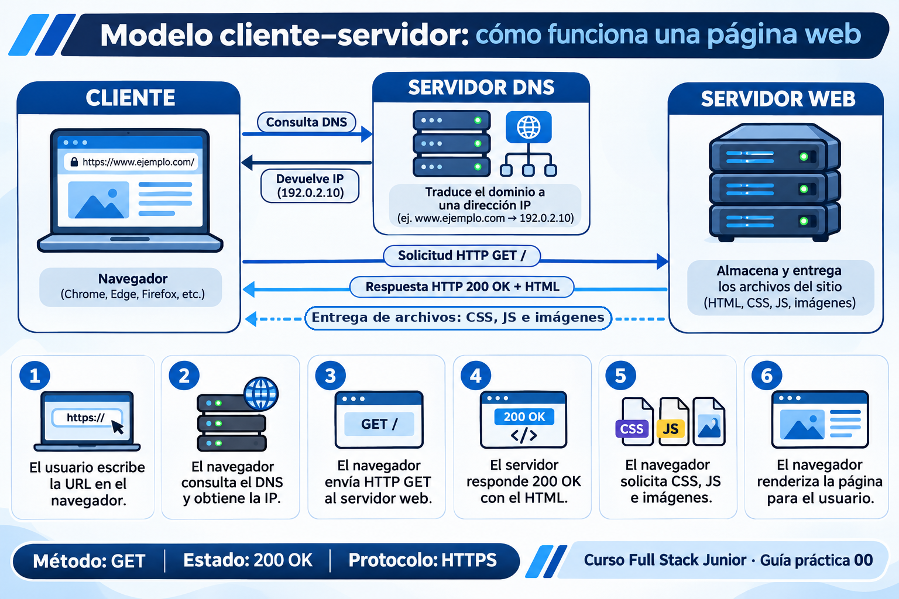
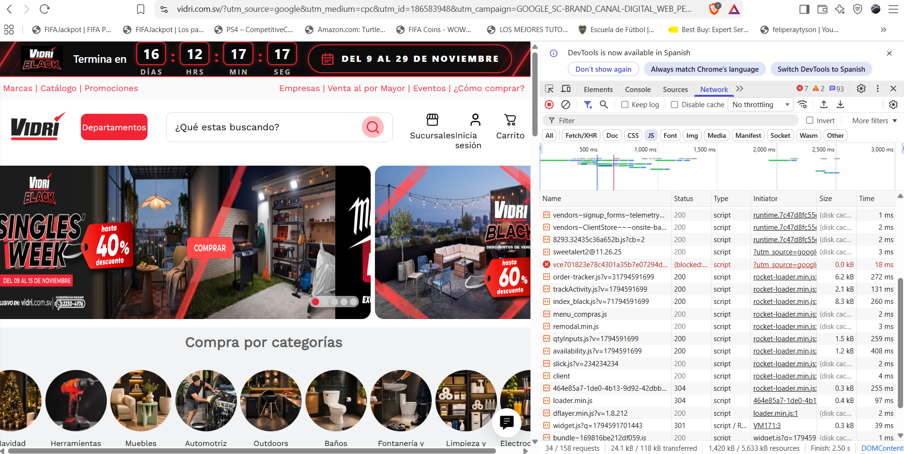

# 📚 Bitácora de Aprendizaje Full Stack

## 👨‍💻 1. Mis datos

- **Nombre:** Brandon Ernesto Molina Pérez
- **Curso:** Desarrollo Web Full Stack
- **Nivel:** Principiante
- **Repositorio:** `bitacora-fullstack`
- **Fecha de inicio:** 13 de noviembre de 2026

## 🎯 2. Objetivo del repositorio

En este repositorio voy a guardar lo que aprenda durante el curso de Desarrollo Web Full Stack.

Aquí iré anotando los temas de cada clase, las actividades que hagamos, las dificultades que tenga y cómo las vaya resolviendo.

Mi objetivo es aprender a crear páginas y aplicaciones web, y mejorar poco a poco con la práctica.

## 📑 3. Tabla de contenido

1. [Mis datos](#-1-mis-datos)
2. [Objetivo del repositorio](#-2-objetivo-del-repositorio)
3. [Tabla de contenido](#-3-tabla-de-contenido)
4. [Registro de clases](#-4-registro-de-clases)
   - [Día 1](#día-1---introducción-al-desarrollo-web)
   - [Día 2](#día-2---próxima-clase)
5. [Tecnologías y herramientas](#-5-tecnologías-y-herramientas)
6. [Reflexión final](#-6-reflexión-final)

## 🗓️ 4. Registro de clases

### Día 1 - Introducción al desarrollo web

**Fecha:** 13/11/2026

**Temas vistos:**
- Qué es el desarrollo web y cómo funciona una página en Internet.
- Qué significan dominio, hosting y servidor.
- Cómo revisar una página con las herramientas del navegador.
- Para qué sirven Git y GitHub.
- Cómo crear un repositorio y escribir un README.
- Cómo usar la inteligencia artificial como ayuda para aprender.

**Actividades realizadas:**
- Creé mi repositorio `bitacora-fullstack` en GitHub.
- Organicé y edité el archivo `README.md`.
- Hice un esquema para explicar cómo se abre una página web.
- Comparé dominio, hosting y servidor.
- Revisé la página de Vidrí con las herramientas del navegador.
- Practiqué cómo guardar cambios con Git.

#### 📌 Esquema cliente-servidor

**¿Cómo funciona?**

1. Primero escribimos la dirección de una página en el navegador.
2. El navegador busca la dirección del servidor con ayuda del DNS.
3. Luego le pide al servidor que le muestre la página. Esa petición puede hacerse con el método **GET**.
4. El servidor responde y envía la información. Si sale **200 OK**, significa que la petición salió bien.
5. Después el navegador recibe otros archivos, como imágenes, estilos y JavaScript.
6. Por último, el navegador junta todo y muestra la página en la pantalla.

**Lo que entendí:** el navegador pide la información, el servidor la envía y así podemos ver la página.

#### 📌 Diferencia entre dominio, hosting y servidor

| Pregunta | Dominio | Hosting | Servidor |
|---|---|---|---|
| **¿Qué es?** | El nombre de una página web. | El servicio donde se guardan los archivos de la página. | La computadora que entrega la información de la página. |
| **¿Para qué sirve?** | Para encontrar una página fácilmente. | Para que la página esté disponible en Internet. | Para responder cuando alguien entra a la página. |
| **¿Cuánto cuesta?** | Un `.com` puede costar unos **$10 a $20 al año**. | Puede ser gratis o costar unos **$3 a $10 al mes** en un plan básico. | Si se alquila uno sencillo, puede costar unos **$5 a $15 al mes**. |
| **Ejemplo** | `vidri.com.sv` | Hostinger | Un servidor Linux con Nginx. |

*Los precios son aproximados y pueden cambiar según el servicio.*

**Un ejemplo sencillo:** el dominio es como la dirección de una tienda, el hosting es el espacio que alquilamos para ponerla y el servidor es el equipo que atiende las visitas.

#### 📌 Página que revisé con DevTools

**Página:** [Vidrí](https://vidri.com.sv/)

Para esta actividad abrí la página de Vidrí, presioné **F12** y entré en la sección **Network** para ver qué archivos cargaba.

- **Solicitudes:** aparecieron **158 en total**. Al usar un filtro se veían **34**, pero no eran todas.
- **Código que observé:** **200 OK**, que significa que la solicitud fue exitosa.
- **Método de la página principal:** todavía debo confirmar si aparece **GET** en la primera solicitud.
- **Tipos de archivos:** encontré un archivo de estilos (`remodal.css`), uno de JavaScript (`remodal.min.js`) y una fuente (`WorkSans-Regular.ttf`).
- **Tiempo:** vi un valor de **2.50 segundos** en **Finish**. Me falta revisar el tiempo exacto que dice **Load**.

**Capturas de la actividad:**

También guardé otras capturas: [archivos CSS](evidencias/devtools-vidri-css.png) y [solicitudes de la página](evidencias/devtools-vidri-fetch-xhr.png).

**Lo que aprendí:**
- Ahora tengo una idea más clara de lo que pasa cuando abro una página web.
- Aprendí a diferenciar un dominio, un hosting y un servidor.
- Pude crear mi repositorio y guardar cambios en GitHub.
- Aprendí a revisar los archivos que carga una página con F12.

**Dificultades encontradas:**
- Al principio no entendía muy bien los números que aparecían en Network.
- También tuve problemas con Git porque escribí unos comandos fuera de la carpeta del repositorio.
- Fui revisando los errores y aprendí que primero debo entrar en la carpeta correcta.

**Recursos utilizados:**
- Guía Práctica 00 del curso.
- [Documentación de GitHub](https://docs.github.com/es/get-started/writing-on-github).
- [Guía de Git en español](https://git-scm.com/book/es/v2).
- ChatGPT, para aclarar dudas y organizar mis apuntes.

#### 🤖 Cómo utilicé la inteligencia artificial

Usé ChatGPT para que me ayudara a ordenar mi README y para que me explicara algunas cosas que no entendía muy bien.

No dejé todo tal como salió. Cambié varias explicaciones para escribirlas de una forma más sencilla y parecida a como yo hablaría. También revisé mis capturas porque al principio había confundido las **158 solicitudes totales** con las **34** que aparecían al aplicar un filtro.

Me di cuenta de que la inteligencia artificial ayuda bastante, pero puede equivocarse. Por eso es importante revisar lo que responde y entenderlo antes de usarlo en una tarea.

### Día 2 - Próxima clase

**Fecha:** Pendiente

**Temas vistos:**
- Pendiente.

**Actividades realizadas:**
- Pendiente.

**Lo que aprendí:**
- Pendiente.

**Dificultades encontradas:**
- Pendiente.

**Recursos utilizados:**
- Pendiente.

<!-- Copiar esta estructura para cada nueva clase -->

## 🛠️ 5. Tecnologías y herramientas

Durante el curso iré aprendiendo a usar:

- Git y GitHub.
- Visual Studio Code.
- HTML.
- CSS.
- JavaScript.
- Herramientas del navegador (F12).
- Otras herramientas que veamos más adelante.

## 📝 6. Reflexión final

Esta primera clase me ayudó a entender mejor cómo funciona una página web y a conocer herramientas que voy a utilizar durante el curso.

Sé que todavía tengo bastante que aprender, pero la idea es seguir practicando, corregir mis errores y dejar aquí un registro de mis avances.
